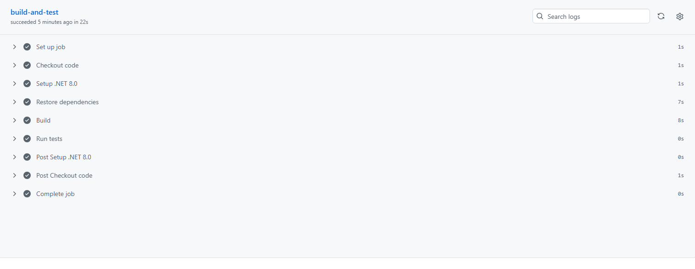

# RaceDay — Part 2: RESTful API

RaceDay is a full-stack, web-based event management system for the South African road running, walking, and cycling community. Part 2 implements the RESTful API that powers RaceDay, built with ASP.NET Core 8.0 and Entity Framework Core (Code-First), matching the Part 1 ERD and endpoint plan exactly.

**Repository:** https://github.com/ST10475058/RaceDay-POE-2.git

## Roles

- **Organiser** – creates, edits, and deletes events; manages categories; captures results; views all enrolments for their events.
- **Participant** – browses events, enters events by selecting a category, views their own enrolments, and tracks personal results.

## Setup and Run

1. Clone the repository:
2. 2. Open `RaceDay.API.sln` in Visual Studio 2022.
3. Update the connection string in `appsettings.json` if needed.
4. Run migrations (Package Manager Console): `Update-Database`
5. Press **F5** to run. Swagger opens at `https://localhost:7XXX/swagger`.

**Prerequisites:** .NET 8.0 SDK · SQL Server (LocalDB/Express) · Visual Studio 2022

## API Endpoints

- **Auth (public):** `POST /api/auth/register` · `POST /api/auth/login`
- **Profile:** `GET /api/users/me` · `PUT /api/users/me`
- **Events:** `GET /api/events` · `GET /api/events/{id}` (public) · `POST /api/events` · `PUT /api/events/{id}` · `DELETE /api/events/{id}` (Organiser)
- **Categories:** `GET /api/events/{eventId}/categories` (public) · `POST /api/events/{eventId}/categories` · `PUT /api/categories/{id}` · `DELETE /api/categories/{id}` (Organiser)
- **Enrolments:** `POST /api/categories/{categoryId}/enrolments` (Participant) · `GET /api/enrolments/me` (Participant) · `GET /api/events/{eventId}/enrolments` (Organiser)
- **Results:** `POST /api/enrolments/{enrolmentId}/results` (Organiser) · `GET /api/results/me` (Participant) · `GET /api/events/{eventId}/results` (public)

## Authentication

JWT Bearer tokens issued on register and login. Passwords hashed with BCrypt.Net-Next. Role-based access enforced via `[Authorize(Roles = "...")]`.

## Unit Tests

Run tests:
Tests cover registration, login, event management, role-based access rejection, and event enrolments.

## CI/CD

CI/CD Green Build

The GitHub Actions workflow builds the project and runs all unit tests on every push. All steps pass successfully.

## Video Walkthrough

[Watch the video walkthrough here](https://youtu.be/your-part2-video-link)

## References

- Microsoft Learn. *ASP.NET Core Web API*. https://learn.microsoft.com/en-us/aspnet/core/web-api/ (accessed October 2026)
- Microsoft Learn. *Entity Framework Core*. https://learn.microsoft.com/en-us/ef/core/ (accessed October 2026)
- Microsoft Learn. *JWT Bearer Authentication*. https://learn.microsoft.com/en-us/aspnet/core/security/authentication/ (accessed October 2026)
- Mozilla Developer Network. *HTTP response status codes*. https://developer.mozilla.org/en-US/docs/Web/HTTP/Status (accessed August 2026)
- Rosebank College. *RaceDay Portfolio of Evidence assignment brief*, 2026
- Anthropic. *Claude (AI assistant)* – Used for structuring and documentation. All design decisions reviewed by the author.
